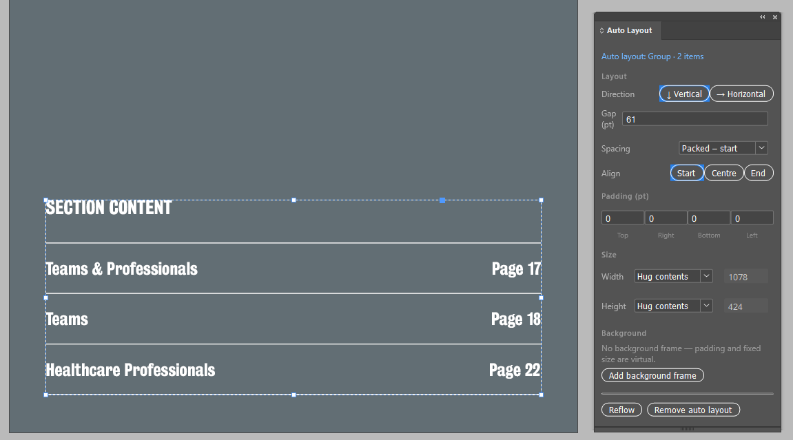

# Flowframe

  

**Figma-style auto layout for Adobe InDesign.** Group elements, then set the direction, gap, padding, alignment and hug or fixed sizing, the same way you would on a Figma frame.



`#InDesign` `#AdobeInDesign` `#UXP` `#InDesignPlugin` `#AutoLayout` `#Figma` `#FigmaToInDesign` `#EditorialDesign` `#PrintDesign` `#DesignTools`

---

## Why Flowframe exists

Flowframe was built during a real project. A large, multi-page interactive publication designed in **Figma** had to be delivered as an **InDesign** file so the client's partner organisation could host and maintain it.

The pages were converted from Figma to InDesign. The conversion reproduced the content, but it **introduced layout errors**:
- the gaps between stacked elements were no longer even
- padding was lost or inconsistent
- text frames reflowed slightly differently because InDesign measures fonts differently from Figma

Figma's auto layout had kept all of these consistent. InDesign has no equivalent, so fixing them meant nudging hundreds of objects by hand.

Flowframe brings that Figma behaviour into InDesign. Select a converted group, give it a gap and padding, and every item snaps back into an even, consistent layout. When text changes, the layout reflows.

## Features

### Layout
- **Direction:** vertical (↓) or horizontal (→) stacking.
- **Gap:** a fixed space between items. The gap is detected automatically when you first add auto layout.
- **Spacing:** packed at the start, centre or end, or *space between* (needs a fixed size).
- **Alignment on the cross axis:** start, centre or end.
- **Padding:** set separately for top, right, bottom and left.

### Sizing
- **Width and height:** *Hug contents* or *Fixed*, as in Figma.
- **Background frame:** an optional rectangle behind the group that resizes with the layout. It works like a Figma frame's fill, and you can give it a colour, stroke and rounded corners.

### Child items
- **Fill container:** stretches an item across the cross axis.
- **Ignore auto layout:** leaves an item out of the layout, like Figma's absolute position.
- **Use as background frame:** turns an existing rectangle inside the group into the background.
- **Make text frame hug its text:** switches on InDesign's auto-sizing for that text frame.

### Workflow
- **Nested auto layouts:** groups inside groups are laid out from the inside out.
- **Order by position:** drag an item to a new place and reflow. The order follows the items' positions on the page, as in Figma.
- **Auto-reflow (optional):** re-lays out groups automatically when their contents change, for example when text grows. It doesn't fight Undo.
- **One undo step:** each change can be undone with a single <kbd>Ctrl</kbd>/<kbd>Cmd</kbd>+<kbd>Z</kbd>.
- **Stored with the document:** settings are saved in script labels on the group, so they travel with the `.indd` file.

## Requirements

- Adobe InDesign **2023 (18.5) or newer**. It was developed and tested on **InDesign 2026 (21.6)**.
- Windows or macOS.

## Installation

### Option A: install the `.ccx` package
1. Build the package (see [Building](#building)) or download it from the Releases page.
2. Double-click `Flowframe.ccx`. Creative Cloud installs it. It may warn that the plugin isn't from the Adobe marketplace.
3. In InDesign, open **Plugins → Flowframe**.

### Option B: load it with UXP Developer Tool
1. Install **UXP Developer Tool** from the Creative Cloud app.
2. Click **Add Plugin** and select `plugin/manifest.json`.
3. Click **Load**. The panel appears in InDesign under **Plugins → Flowframe**.

## Usage

1. **Add auto layout.** Select a group, or several objects (Flowframe groups them for you), and click **Add auto layout**.
2. **Adjust the settings.** Change the direction, gap, padding, alignment and sizing in the panel. Every change applies immediately.
3. **Edit one item.** Select it with the **Direct Selection** tool. The *Selected child* section shows its options: fill, ignore, background and hug text.
4. **Reorder.** Move an item past its neighbour and click **Reflow**.
5. **Keep it live (optional).** Tick **Auto-reflow when contents change**.
6. **Reflow a whole spread.** **Reflow all on this spread** updates every auto layout on the current spread at once.

> **Tip:** to fix a converted page, select each stacked block, add auto layout and type the gap from the original design. All the uneven spacing is corrected in one step.

## Keyboard shortcuts

Flowframe adds four commands to the **Plugins → Flowframe** menu. You can give each one a keyboard shortcut, just like in Figma.

| Command | Suggested shortcut (as in Figma) |
|---|---|
| Add auto layout | <kbd>Shift</kbd>+<kbd>A</kbd> |
| Remove auto layout | <kbd>Alt</kbd>/<kbd>Option</kbd>+<kbd>Shift</kbd>+<kbd>A</kbd> |
| Reflow selected auto layout | your choice, e.g. <kbd>Ctrl</kbd>/<kbd>Cmd</kbd>+<kbd>Alt</kbd>+<kbd>R</kbd> |
| Reflow all on this spread | your choice |

To set them up:
1. In InDesign, open **Edit → Keyboard Shortcuts…**
2. Create a new set. The *Default* set can't be edited.
3. Under **Product Area**, choose the plug-ins / Plug-in Menu area and find the **Flowframe** commands.
4. Click in **New Shortcut**, press your keys and click **Assign**. InDesign warns you if the shortcut is already taken.

> UXP plugins can't register shortcuts on their own, so this one-time setup in InDesign is needed.

## How it works

Flowframe is a UXP panel plugin written in plain JavaScript, with no build step and no dependencies.
- The settings for each auto layout are stored as JSON in a script label on the InDesign group.
- The layout engine measures each item's visible bounds in points.
- It orders the items along the main axis by their current position, then moves them into place. It resizes only text frames and shapes, never nested groups, because resizing a group would scale its contents.
- Auto-reflow keeps a lightweight signature of each group's contents. It reflows only the groups whose signature has changed, and pauses while the document has something to redo, so Undo keeps working.

```
plugin/
├── manifest.json   # UXP manifest (InDesign 18.5+)
├── index.html      # panel UI
├── index.js        # layout engine + panel logic
└── icons/
```

## Building

A `.ccx` file is a zip archive of the plugin folder:

```bash
./build.sh          # creates dist/Flowframe.ccx
```

## Limitations and roadmap

- [ ] Units follow points only. Document units are planned.
- [ ] Wrap mode, for rows that wrap onto the next line.
- [ ] *Fill* for nested groups.
- [ ] Per-item min and max sizes.
- [ ] Spacing presets, or tokens shared across a document.

## Changelog

Current version: **1.2.5**. The full history is in [CHANGELOG.md](CHANGELOG.md).

## Author

Designed and built by **Pawel Cieslak**, [Lucmedia](https://www.lucmedia.pl).

## Licence

[MIT](LICENSE)
